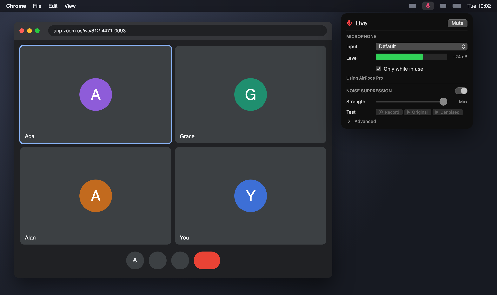
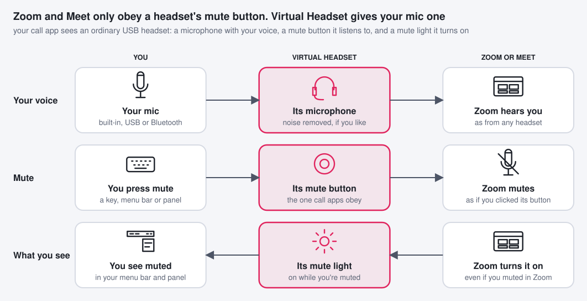
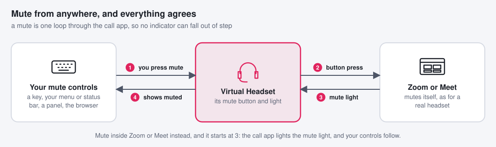

# Virtual Headset

[](https://github.com/xav-ie/virtual-headset/actions/workflows/ci.yml)
[](https://github.com/xav-ie/virtual-headset/releases/latest)
[](LICENSE.md)

**A mute button for any microphone that Zoom and Google Meet actually obey, on
Linux and macOS.** Your call app sees a real USB telephony headset, so a key, your
status bar, or your browser toolbar mutes the call, and muting inside the call
updates all of them too.



- **Mute that the call app respects.** Zoom and Meet treat Virtual Headset's
  button like a headset's: they mute themselves and light its mute light back,
  so your key, your bar and the call app never disagree.
- **Any mic.** The built-in mic, a USB mic, or Bluetooth earbuds; nothing to
  buy.
- **Mute from anywhere.** A keyboard shortcut, your status bar or menu bar, a
  panel, the Firefox toolbar, or a script.
- **Bluetooth that sounds right on macOS.** While you're muted, Virtual Headset
  lets go of the mic, so earbuds switch back from tinny hands-free audio to full
  stereo, and back again when you unmute.
- **Background noise removed, on your Mac.** Optional [DeepFilterNet
  3](https://github.com/Rikorose/DeepFilterNet) noise suppression runs on your
  own computer, with an A/B test to hear the difference.
- **In the browser too.** Chrome and other Chromium browsers talk to the
  headset directly; a small extension does it for Firefox.
- **Starts muted on Linux,** so you're never live by accident after logging in.
- **Nix modules** for NixOS, nix-darwin and Home Manager.

## What you need

| Part      | Needs                                                                                                                                                                   |
| --------- | ----------------------------------------------------------------------------------------------------------------------------------------------------------------------- |
| Linux     | PipeWire, on any distribution ([NixOS module](docs/installation.md#nixos) included)                                                                                     |
| macOS     | Nix, and the `amfi_get_out_of_my_way=1` boot argument, which needs System Integrity Protection turned off; see [why](docs/macos.md#why-the-boot-argument) before you do |
| Your call | Zoom (web or desktop) or Google Meet, in Chrome or another Chromium browser; Firefox with [the extension](docs/browser-extension.md)                                    |

## How it works

<!-- diagram:how-it-works -->
<picture>
  <source media="(prefers-color-scheme: dark)" srcset="docs/diagrams/how-it-works-dark.svg">
  
</picture>
<!-- /diagram:how-it-works -->

In your call app's settings, the headset shows up as two devices:
**Virtual_Headset_Microphone**, the mic carrying your voice, and
**Virtual_Headset**, its mute button. Zoom pairs them because their names match,
and from then on treats them as one headset.

## Quick start

**Linux, with NixOS:**

```nix
{
  inputs.virtual-headset.url = "github:xav-ie/virtual-headset";

  # in your NixOS configuration
  imports = [ inputs.virtual-headset.nixosModules.default ];
  services.virtual-headset = {
    enable = true;
    user = "you";
  };
}
```

**macOS, with nix-darwin:**

```nix
{
  inputs.virtual-headset.url = "github:xav-ie/virtual-headset";

  # in your nix-darwin configuration
  imports = [ inputs.virtual-headset.darwinModules.default ];
  services.virtual-headset.enable = true;
}
```

Not using Nix on Linux? See [installation](docs/installation.md#without-nix).

**Then, in your call:**

1. Choose **Virtual_Headset_Microphone** as your microphone.
2. In Zoom, open **Settings → Audio**, turn on **Sync buttons on headset**, and
   connect **Virtual_Headset** when the browser asks.
3. Press mute: `virtual-headset-ctl toggle-mute` on Linux, `virtual-headset
toggle-mute` on macOS. Bind it to a key.

## Mute from anywhere

| Where           | Linux                                                                    | macOS                                                                |
| --------------- | ------------------------------------------------------------------------ | -------------------------------------------------------------------- |
| **Keyboard**    | bind `virtual-headset-ctl toggle-mute`                                   | bind `virtual-headset toggle-mute` (skhd, Raycast, …)                |
| **Your bar**    | [Waybar, i3 or Polybar](docs/status-bar.md)                              | [any menu bar tool](docs/macos.md#your-menu-bar), e.g. SketchyBar    |
| **A panel**     | the [desktop panel](docs/status-bar.md#desktop-panel), with a mic picker | the [settings panel](docs/macos.md#the-panel)                        |
| **The browser** | the [Firefox extension](docs/browser-extension.md)                       | Chrome's own headset support                                         |
| **Scripts**     | `virtual-headset-ctl` or [D-Bus](docs/usage.md#d-bus)                    | `virtual-headset` and [its state files](docs/macos.md#your-menu-bar) |

<!-- diagram:mute-loop -->
<picture>
  <source media="(prefers-color-scheme: dark)" srcset="docs/diagrams/mute-loop-dark.svg">
  
</picture>
<!-- /diagram:mute-loop -->

## Stereo while you're muted, on macOS

A Bluetooth headset can't play stereo and carry your voice at the same time, so
whenever an app holds its mic, macOS switches it to mono call audio. Most call
apps hold the mic for the whole meeting; Virtual Headset only while you're live:

<!-- diagram:bluetooth -->
<picture>
  <source media="(prefers-color-scheme: dark)" srcset="docs/diagrams/bluetooth-dark.svg">
  
</picture>
<!-- /diagram:bluetooth -->

## Documentation

- [Installation](docs/installation.md): NixOS, nix-darwin, Home Manager, and without Nix
- [Using it](docs/usage.md): day to day, and the CLI, D-Bus and HID reference
- [macOS](docs/macos.md): the panel, noise suppression, Bluetooth, and your menu bar
- [Status bars and the panel](docs/status-bar.md) on Linux
- [Firefox](docs/browser-extension.md): the extension that syncs Zoom and Meet tabs
- [How it works](docs/architecture.md): the devices, the reports, and why Zoom trusts them
- [Troubleshooting](docs/troubleshooting.md)
- [Development](docs/development.md)

## Credits

- [Make your first steps with a USB HID Report](https://www.noser.com/techblog/first-steps-with-an-usb-hid-report/)
- [Introduction to HID report descriptors](https://www.kernel.org/doc/html/latest/hid/hidintro.html)
- [UHID: user-space I/O driver support for HID](https://www.kernel.org/doc/html/latest/hid/uhid.html)
- [uhid-virt](https://crates.io/crates/uhid-virt) for the Linux HID device
- [BlackHole](https://github.com/ExistentialAudio/BlackHole), the base of the macOS microphone
- [DeepFilterNet](https://github.com/Rikorose/DeepFilterNet) and [RNNoise](https://github.com/xiph/rnnoise) for noise suppression

## License

[MIT](LICENSE.md)
