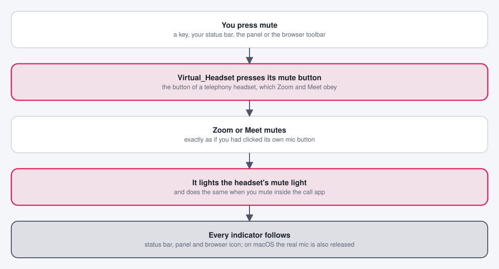
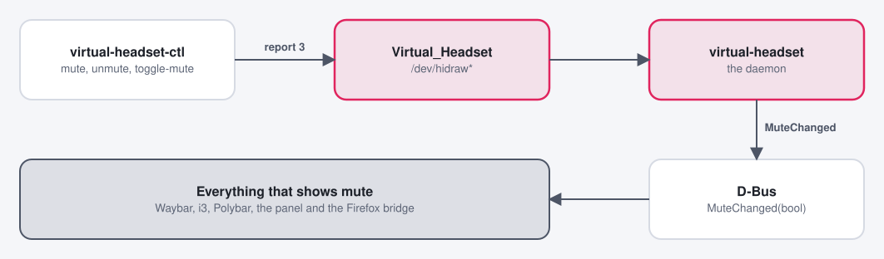

# How it works

<!-- diagram:how-it-works -->
<picture>
  <source media="(prefers-color-scheme: dark)" srcset="diagrams/how-it-works-dark.svg">
  
</picture>
<!-- /diagram:how-it-works -->

Virtual Headset makes two devices and keeps them together:

- **Virtual_Headset_Microphone**, an audio input carrying your real mic.
- **Virtual_Headset**, a USB HID telephony headset: a hook switch, a mute
  button, and mute, off-hook and ring lights.

The call app does the muting itself, as it would for a real headset, so
Virtual Headset never silences anything system-wide and there's nothing to undo
if it stops.

- [The headset](#the-headset)
- [Why Zoom trusts it](#why-zoom-trusts-it)
- [Linux](#linux)
- [macOS](#macos)

## The headset

Both platforms present the same device, posing as a Jabra Evolve2 65 (vendor
`0x0b0e`, product `0x245e`) because call apps look for known headset makers:

| Report    | Direction     | Contents                                                        |
| --------- | ------------- | --------------------------------------------------------------- |
| 1, input  | headset → app | hook switch (bit 0, absolute) and mute button (bit 1, relative) |
| 2, output | app → headset | mute light (bit 0), off-hook light (bit 1), ring light (bit 2)  |
| 3, output | you → headset | a command: `0x01` mute, `0x02` unmute, `0x03` toggle            |

A mute press is a 0 → 1 → 0 pulse on the relative mute bit, with the hook bit
held at 1 (in a call). The call app toggles its own mute and answers on report 2,
which is how every indicator learns the real state, including when you mute in
the app.

<!-- diagram:mute-round-trip -->
<picture>
  <source media="(prefers-color-scheme: dark)" srcset="diagrams/mute-round-trip-dark.svg">
  
</picture>
<!-- /diagram:mute-round-trip -->

## Why Zoom trusts it

Zoom's web client pairs a WebHID headset with the selected microphone by name:

```javascript
device = devices.find((d) => audioLabel.includes(d.productName));
```

`"Virtual_Headset_Microphone"` includes `"Virtual_Headset"`, so the two pair.
That's why Virtual Headset makes its own microphone rather than a headset for
whichever mic you already use. Google Meet doesn't check names, so with Meet any
mic works.

## Linux

<!-- diagram:control-paths -->
<picture>
  <source media="(prefers-color-scheme: dark)" srcset="diagrams/control-paths-dark.svg">
  
</picture>
<!-- /diagram:control-paths -->

- **The headset** is made with `/dev/uhid`, so the kernel and the browser see it
  as `/dev/hidraw*`.
- **The microphone** is a PipeWire loopback from your chosen (or default) source:

  ```sh
  pw-loopback \
    --capture-props "target.object=<your mic> node.name=loopback_capture" \
    --playback-props "media.class=Audio/Source node.name=Virtual_Headset_Mic node.description=Virtual_Headset_Microphone"
  ```

  Its capture side is passive, so the mic only runs while something records
  from Virtual_Headset_Microphone, and muting unlinks it, so your mic and any
  denoiser in front of it (such as NoiseTorch) go idle until you unmute.

- **Control** comes in as report 3 from `virtual-headset-ctl`, or over D-Bus,
  where the daemon also announces `MuteChanged` for status bars and the
  [Firefox bridge](browser-extension.md).

## macOS

- **The headset** is made from user space with `IOHIDUserDevice`. That needs the
  `com.apple.developer.hid.virtual.device` entitlement, which an ad-hoc signed
  app only gets with `amfi_get_out_of_my_way=1` (see
  [why](macos.md#why-the-boot-argument)).
- **The microphone** is a [BlackHole](https://github.com/ExistentialAudio/BlackHole)
  loopback driver renamed to Virtual_Headset_Microphone at build time. The app
  captures your mic, optionally denoises it with DeepFilterNet 3 (in process) or
  RNNoise (through ffmpeg), and plays it into the driver.
- **While the call is muted** the app closes your real mic, so a Bluetooth
  headset can return to stereo:

<!-- diagram:bluetooth -->
<picture>
  <source media="(prefers-color-scheme: dark)" srcset="diagrams/bluetooth-dark.svg">
  
</picture>
<!-- /diagram:bluetooth -->

- **Control** is the `virtual-headset` command, which messages the running app;
  its state goes to files in `~/.cache/virtual-headset` and a distributed
  notification, for [menu bars](macos.md#your-menu-bar).
