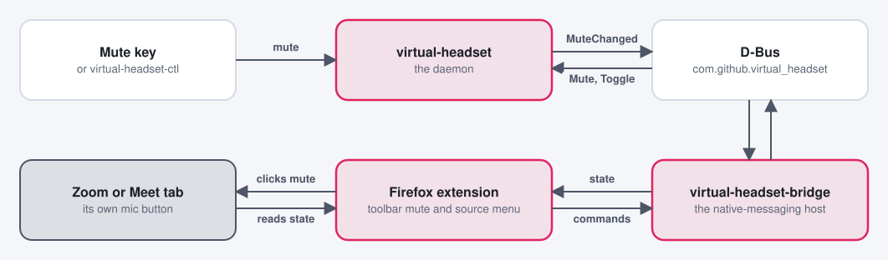

# Firefox

## Do you need it?

Only if you take calls in Firefox:

| You take calls in                                                    | Extension?                                  |
| -------------------------------------------------------------------- | ------------------------------------------- |
| Zoom's desktop app                                                   | No: it talks to the headset itself          |
| Zoom or Meet in Chrome, Edge, Brave, Arc or another Chromium browser | No: they talk to the headset through WebHID |
| Zoom or Meet in **Firefox**                                          | **Yes**                                     |

Firefox can't talk to USB headsets (it has no WebHID), so in a Firefox tab Zoom
and Meet never see Virtual Headset. Without the extension:

- your mute key and status bar don't mute the call, and
- nothing outside the tab knows whether you're muted, so your status bar, menu
  bar and panel can't show it, and on a Mac your mic stays open while muted, so
  a Bluetooth headset stays in call audio.

With it, a Firefox call behaves like any other: your mute key mutes the tab,
muting in the tab updates everything else, and on a Mac you hear stereo while
you're muted.

## How it works

The extension works on Linux and macOS and keeps mute in sync both ways:

- Press your mute key or click your status bar, and the Zoom or Meet tab mutes:
  the extension clicks its mic button.
- Mute in the tab, and your status bar and panel follow.

<!-- diagram:firefox-bridge -->
<picture>
  <source media="(prefers-color-scheme: dark)" srcset="diagrams/firefox-bridge-dark.svg">
  
</picture>
<!-- /diagram:firefox-bridge -->

**On macOS** the meeting tab becomes your call. While it's open, the menu bar
and the panel show whether you're live or muted, your mic is released while
you're muted (so Bluetooth headsets play stereo), and your mute key, the panel's
Mute button and the toolbar all press the tab's mic button. If a call app is
also connected to the headset, the headset's call comes first.

## Using it

- **Click** the toolbar mic to toggle mute. Red means live; grey with a slash,
  muted.
- **Right-click** it for **Audio source**, to pick which mic the headset
  forwards, and **Restart service** (on macOS, the Virtual Headset app).

## Install, with nix-darwin

On macOS, the nix-darwin module can register the helper for every user:

```nix
{
  services.virtual-headset = {
    enable = true;
    firefox = true;
  };
}
```

Then download `virtual_headset.xpi` from the
[latest release](https://github.com/xav-ie/virtual-headset/releases/latest) and
open it in Firefox. It's signed by Mozilla, so it stays installed and updates
itself.

## Install, with Home Manager

```nix
{
  imports = [ inputs.virtual-headset.homeManagerModules.firefox ];
  programs.virtual-headset-firefox = {
    enable = true;
    # Install the Mozilla-signed extension, kept up to date. Needs programs.firefox.
    installExtension = true;
  };
}
```

This registers the helper Firefox talks to (the native-messaging host
`virtual-headset-bridge`), on Linux or macOS, and with `installExtension` has
Firefox install the signed extension from the latest release in every profile,
and update it, with no prompts. `installExtension` works through Home Manager's
Firefox policies, so it needs `programs.firefox` to manage your Firefox; on a Mac
whose Firefox is installed some other way, open the `.xpi` instead.

If your `programs.firefox` package override drops the policies Home Manager sets,
add the same `ExtensionSettings` through your override's `extraPolicies`.

## Install, without Nix

Build the helper and register it with Firefox. On Linux:

```sh
cargo build --release --manifest-path packages/virtual-headset/Cargo.toml
extension/static/install-native-host.sh \
  packages/virtual-headset/target/release/virtual-headset-bridge
```

On macOS:

```sh
nix build github:xav-ie/virtual-headset
extension/static/install-native-host.sh result/bin/virtual-headset-bridge
```

Then download `virtual_headset.xpi` from the
[latest release](https://github.com/xav-ie/virtual-headset/releases/latest) and
open it in Firefox. It's signed by Mozilla.

On Linux, the **Audio source** menu needs `virtual-headset-ctl` on the helper's
`PATH` (the Nix package does this for you).

## When Zoom or Meet change

Zoom and Meet change their pages without notice, and the extension finds their
mic buttons by reading the page. If syncing stops, the fix is usually in
[`extension/src/content.ts`](../extension/src/content.ts): each site's adapter
finds the mic button and reads whether it means "muted". See
[development](development.md#the-firefox-extension) to build and test it.
