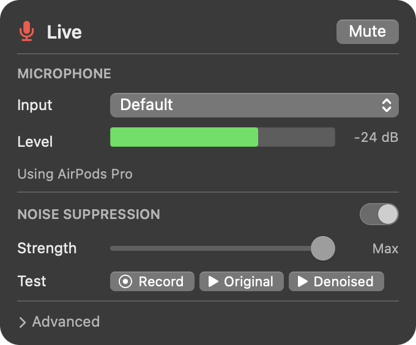
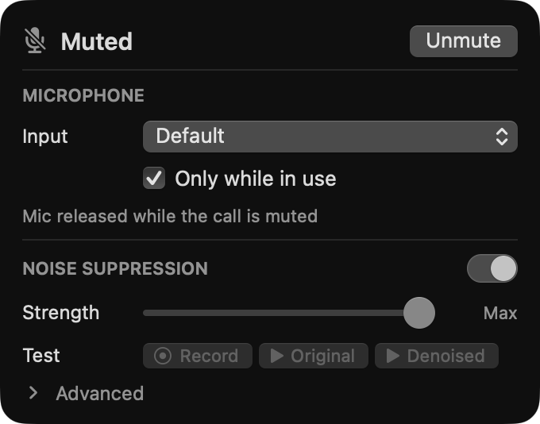
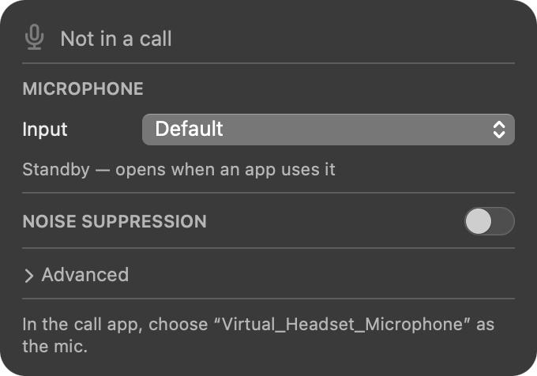
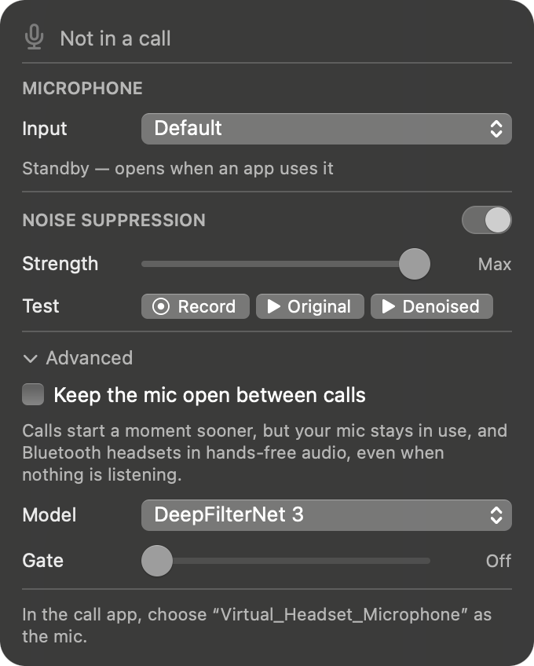
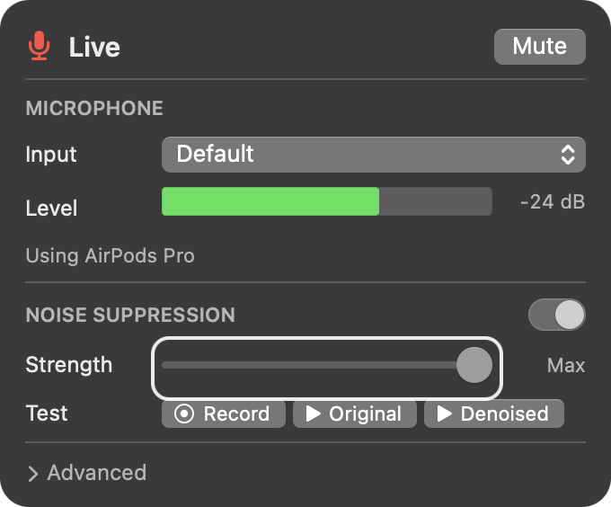
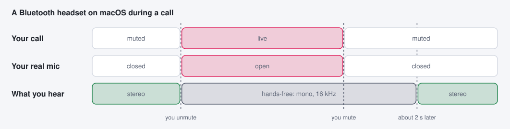

# Virtual Headset on macOS

On a Mac, Virtual Headset is one small app that runs in the background. It
forwards your real mic into **Virtual_Headset_Microphone**, can remove background
noise on the way, and presents **Virtual_Headset**, the headset whose mute button
Zoom and Meet sync with.

- [Install](#install)
- [The panel](#the-panel)
- [Noise suppression](#noise-suppression)
- [Advanced](#advanced)
- [Keyboard and VoiceOver](#keyboard-and-voiceover)
- [Bluetooth headsets](#bluetooth-headsets)
- [Your menu bar](#your-menu-bar)
- [Why the boot argument](#why-the-boot-argument)

## Install

With [nix-darwin](https://github.com/nix-darwin/nix-darwin):

```nix
{
  inputs.virtual-headset.url = "github:xav-ie/virtual-headset";

  # in your nix-darwin configuration
  imports = [ inputs.virtual-headset.darwinModules.default ];
  services.virtual-headset.enable = true;
}
```

This starts the app at login (and restarts it after updates), puts the
`virtual-headset` command on your `PATH`, and installs the
Virtual_Headset_Microphone audio driver. Installing or updating the driver
restarts macOS's audio service, so sound drops for a moment: switch between calls.

You also need the `amfi_get_out_of_my_way=1` [boot argument](#why-the-boot-argument),
and Nix's sandbox set to `relaxed` (or off), because the build signs the app with
Apple's `codesign`.

<details>
<summary><b>Without nix-darwin</b></summary>

```sh
nix build github:xav-ie/virtual-headset#virtual-headset-driver -o driver
sudo cp -R driver/Library/Audio/Plug-Ins/HAL/VirtualHeadset.driver /Library/Audio/Plug-Ins/HAL/
sudo killall coreaudiod

nix build github:xav-ie/virtual-headset -o virtual-headset
./virtual-headset/Applications/virtual-headset.app/Contents/MacOS/virtual-headset &
```

To start it at login, run that last path from a launchd agent with `KeepAlive`
(that's what the module does).

</details>

Then in your call app choose **Virtual_Headset_Microphone** as the mic, and in
Zoom turn on **Settings → Audio → Sync buttons on headset** and connect
**Virtual_Headset**. Zoom's desktop app and Zoom in Chrome both work; for Zoom
or Meet in Firefox, add [the extension](browser-extension.md).

## The panel

`virtual-headset panel` opens the settings panel; bind it to a key or a
[menu bar item](#your-menu-bar). In a call it leads with the call's mic:

|                                                                                                                Live                                                                                                                 |                                                                                              Muted                                                                                              |                                                                     Between calls                                                                     |
| :---------------------------------------------------------------------------------------------------------------------------------------------------------------------------------------------------------------------------------: | :---------------------------------------------------------------------------------------------------------------------------------------------------------------------------------------------: | :---------------------------------------------------------------------------------------------------------------------------------------------------: |
|  |  |  |

- **Live / Muted** is the call's own mute state, read from the headset's mute
  light, and the button presses the headset's mute button.
- **Input** is the mic to forward. **Default** follows macOS's input, so
  plugging in a headset just works; the line under it says which mic is in use.
- **Level** shows while the mic is open. Your mic opens only while an app
  records from Virtual_Headset_Microphone, so between calls it, and macOS's
  orange mic-in-use dot, stay off.

## Noise suppression

Turn it on in the panel to remove background noise (keyboards, fans, music,
street noise) before your call hears you. It runs [DeepFilterNet
3](https://github.com/Rikorose/DeepFilterNet) on your own Mac, using about a tenth
of one core, and adds about 20 ms of delay.

- **Strength** limits how much noise it removes. Past about 40 dB there's no
  audible difference, so the slider ends there, at **Max**.
- **Test** records 8 seconds of your raw mic, then plays it back as it was or
  through your current settings. Change a setting and play it again to compare
  the same take.

Turned off, your mic goes through untouched.

## Advanced



Settings almost nobody should change, at the bottom of the panel:

- **Keep the mic open between calls.** Calls start a moment sooner, but your mic
  stays in use, and a Bluetooth headset stays in call audio, even while nothing
  is listening. Off by default.
- **Model** picks the noise suppression engine: DeepFilterNet 3, or one of five
  [RNNoise](https://github.com/xiph/rnnoise) models.
- **Gate** silences the gaps between your words.

Model and Gate show while noise suppression is on. RNNoise and the gate both
scored worse in our speech-quality benchmarks, which is why they're here.

<br clear="right">

## Keyboard and VoiceOver



The panel takes the keyboard while it's open, whether or not macOS's Keyboard
navigation setting is on:

| Key                  |                           |
| -------------------- | ------------------------- |
| Tab, Shift-Tab, ↑, ↓ | move between controls     |
| Space, Return        | press the focused control |
| ←, →                 | adjust the focused slider |
| Escape, ⌘W           | close the panel           |

A ring marks the focused control once you use the keyboard, and goes away when
you click. VoiceOver reads each control by its row's name ("Input",
"Strength"), the mute button as "Mute the call" or "Unmute the call", and
whether Advanced is open.

<br clear="right">

## Bluetooth headsets

<!-- diagram:bluetooth -->
<picture>
  <source media="(prefers-color-scheme: dark)" srcset="diagrams/bluetooth-dark.svg">
  
</picture>
<!-- /diagram:bluetooth -->

macOS can't play stereo to a Bluetooth headset and record from its mic at the
same time, so the headset's sound follows its mic, not your call. A call app
holding the mic keeps you on mono call audio for the whole meeting; Virtual
Headset closes the mic whenever you're muted, so you're back to stereo within a
couple of seconds of muting.

## Your menu bar

Any menu bar tool can show the call's mute state and toggle it. The app writes
its state to files and posts a notification whenever it changes:

| File                             | Contents                                                                  |
| -------------------------------- | ------------------------------------------------------------------------- |
| `~/.cache/virtual-headset/call`  | `none`, `muted` or `unmuted`, from the call app's mute light              |
| `~/.cache/virtual-headset/state` | `on` (denoising), `raw` (forwarding as is), `muted`, `standby` or `error` |
| `~/.cache/virtual-headset/nudge` | appears when a mute press had no call to mute; flash, then delete it      |

The notification is the distributed notification
`com.github.virtual-headset.changed`. With
[SketchyBar](https://github.com/FelixKratz/SketchyBar):

```sh
sketchybar --add event virtual_headset_changed com.github.virtual-headset.changed
sketchybar --add item virtual_headset right \
  --set virtual_headset script="$CONFIG_DIR/plugins/virtual_headset.sh" \
        click_script="virtual-headset panel" \
  --subscribe virtual_headset virtual_headset_changed
```

```sh
#!/bin/sh
# plugins/virtual_headset.sh: the call's mic, or nothing between calls
case "$(cat ~/.cache/virtual-headset/call 2>/dev/null)" in
  muted)   sketchybar --set "$NAME" drawing=on icon=󰍭 icon.color=0xffffffff ;;
  unmuted) sketchybar --set "$NAME" drawing=on icon=󰍬 icon.color=0xffe0245e ;;
  *)       sketchybar --set "$NAME" drawing=off ;;
esac
```

The commands for your keys and clicks:

| Command                                          |                                                             |
| ------------------------------------------------ | ----------------------------------------------------------- |
| `virtual-headset toggle-mute`                    | press the headset's mute button                             |
| `virtual-headset mute`, `virtual-headset unmute` | only press it if that changes something                     |
| `virtual-headset panel [x]`                      | open or close the panel, under screen position `x` if given |

## Why the boot argument

Virtual Headset has to create a USB headset in software, which macOS reserves
for apps Apple has granted a special entitlement. With
`amfi_get_out_of_my_way=1`, macOS honors entitlements an app grants itself, so
the app can create the headset; the same setting is what lets it use your
microphone, since apps can't show macOS's permission prompt under it.

Setting the argument needs System Integrity Protection off, which lowers your
Mac's defenses against malicious software. Only do it if you understand that
trade:

1. Start up in macOS Recovery and run `csrutil disable`.
2. Back in macOS: `sudo nvram boot-args="amfi_get_out_of_my_way=1"`, then restart.

<details>
<summary><b>Licenses</b></summary>

Virtual Headset is MIT licensed. The Virtual_Headset_Microphone driver is
[BlackHole](https://github.com/ExistentialAudio/BlackHole), renamed at build time,
and keeps BlackHole's GPL-3.0 license.

</details>
