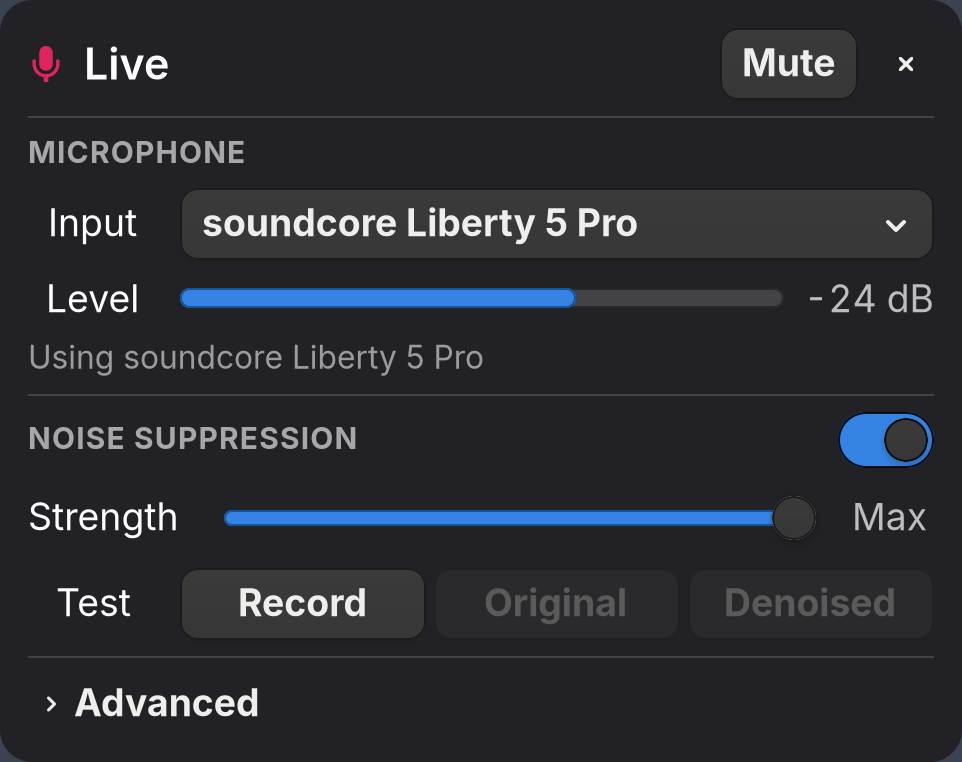
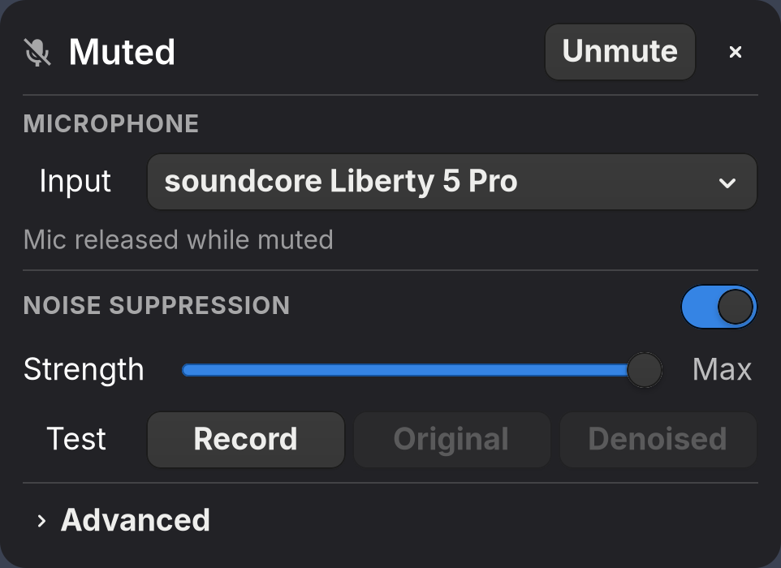
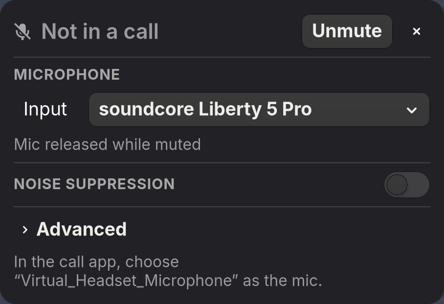
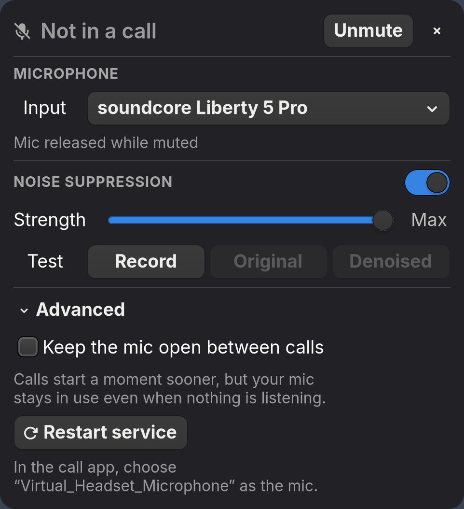
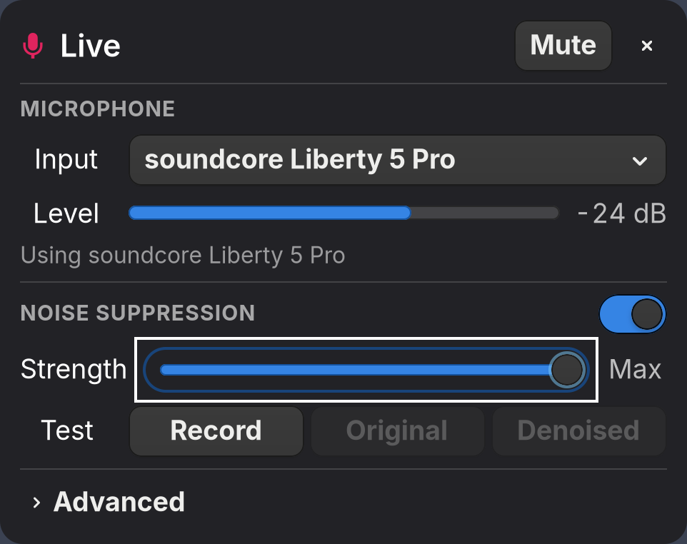

# Status bars and the panel (Linux)

Every indicator reads the same `MuteChanged` signal and acts through
`virtual-headset-ctl`, so they agree with each other, your keys, the browser and
the call app. On macOS, see [your menu bar](macos.md#your-menu-bar) instead.

- [Waybar](#waybar)
- [Desktop panel](#desktop-panel)
- [Other status bars](#other-status-bars)

## Waybar

The Home Manager module adds an indicator that updates the moment mute changes,
toggles on click, and restarts the service on right-click:

```nix
{
  imports = [ inputs.virtual-headset.homeManagerModules.default ];

  programs.virtual-headset-waybar = {
    enable = true;
    mutedIcon = " "; # any text or Nerd Font icon
    unmutedIcon = " ";
  };

  programs.waybar.settings.mainBar.modules-right = [ "custom/virtual-headset" ];
}
```

Styling and the other options are in
[homeManagerModules/default.nix](../homeManagerModules/default.nix).

## Desktop panel

`virtual-headset-panel` is an [AGS](https://github.com/aylur/ags) panel laid out
like the [macOS one](macos.md#the-panel), in your desktop's theme:

|                                                                                                                          Live                                                                                                                          |                                                                                           Muted                                                                                            |                                                                                                              Between calls                                                                                                              |
| :----------------------------------------------------------------------------------------------------------------------------------------------------------------------------------------------------------------------------------------------------: | :----------------------------------------------------------------------------------------------------------------------------------------------------------------------------------------: | :-------------------------------------------------------------------------------------------------------------------------------------------------------------------------------------------------------------------------------------: |
|  |  |  |

- **The call** first: Live or Muted with the button that flips it, or "Not in a
  call" (the mute button stays: on Linux it gates the mic itself).
- **Microphone:** which mic to forward, its level while the mic is open, and
  what it's doing.
- **Noise suppression:** on or off, its strength, and a test that records 8 s
  of your mic, then plays it as it was or denoised.
- **Advanced:** keep the mic open between calls, and restart the service.

|                                                                                          Advanced                                                                                           |                                                           Keyboard                                                            |
| :-----------------------------------------------------------------------------------------------------------------------------------------------------------------------------------------: | :---------------------------------------------------------------------------------------------------------------------------: |
|  |  |

Tab and Shift-Tab move between controls with a visible focus ring, Space and
Return press them, and Escape closes the panel. Screen readers get each
control's name.

```sh
nix run .#virtual-headset-panel             # show it
nix run .#virtual-headset-panel -- toggle   # show or hide a running one
```

Bind `virtual-headset-panel toggle` to a key or a status bar click. Picking
another mic, or turning noise suppression or Keep the mic open on or off,
restarts the service, so the mic drops for about a second: do it between calls.
Strength changes apply live.

## Other status bars

Anything that runs a command works. For live updates instead of polling, read
`virtual-headset-ctl monitor-mute`, which prints a line of JSON on every change;
that's what the Waybar module does.

**i3blocks**

```ini
[virtual-headset]
command=dbus-send --session --print-reply --dest=com.github.virtual_headset /com/github/virtual_headset com.github.virtual_headset.Mute.IsMuted | grep -q "boolean true" && echo "🔇" || echo "🔊"
interval=1
signal=10
```

**Polybar**

```ini
[module/virtual-headset]
type = custom/script
exec = dbus-send --session --print-reply --dest=com.github.virtual_headset /com/github/virtual_headset com.github.virtual_headset.Mute.IsMuted | grep -q "boolean true" && echo "🔇" || echo "🔊"
interval = 1
click-left = virtual-headset-ctl toggle-mute
```
