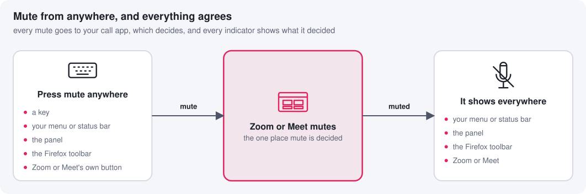

# Using it

Day to day, you'll do three things: pick **Virtual_Headset_Microphone** in your
call app, connect **Virtual_Headset** once in Zoom, and press mute. The rest of
this page is the reference for scripting it.

- [In your call](#in-your-call)
- [Mute](#mute)
- [Linux: virtual-headset-ctl](#linux-virtual-headset-ctl)
- [Linux: D-Bus](#d-bus)
- [Linux: HID reports](#hid-reports)
- [macOS](#macos)

## In your call

1. Choose **Virtual_Headset_Microphone** as your microphone.
2. **Zoom:** open **Settings → Audio** and turn on **Sync buttons on headset**.
   In the browser, Zoom asks to connect a HID device: pick **Virtual_Headset**.
   Zoom only pairs the headset with a mic whose name contains its name, which is
   why the mic must be Virtual_Headset_Microphone.
3. **Google Meet** pairs with the headset whatever mic you choose.
4. **Firefox** can't talk to headsets at all; use [the extension](browser-extension.md),
   on Linux or macOS.

## Mute

<!-- diagram:mute-anywhere -->
<picture>
  <source media="(prefers-color-scheme: dark)" srcset="diagrams/mute-anywhere-dark.svg">
  
</picture>
<!-- /diagram:mute-anywhere -->

A mute press is a headset's button press, so the call app decides what it
means: if you're live it mutes, if you're muted it unmutes. On Linux, Virtual
Headset starts **muted** after login.

**Push to talk** (Linux): bind `virtual-headset-ctl ptt-press` to a key's press
and `ptt-release` to its release. Hold the key to talk; tap it (under 300 ms) to
stay unmuted until the next press.

## Linux: virtual-headset-ctl

| Command                                        |                                                            |
| ---------------------------------------------- | ---------------------------------------------------------- |
| `toggle-mute`, `mute`, `unmute`                | press the mute button (through the headset: most reliable) |
| `toggle-mute-dbus`, `mute-dbus`, `unmute-dbus` | the same, through D-Bus                                    |
| `ptt-press`, `ptt-release`                     | push to talk: hold to talk, tap to latch                   |
| `get-source`                                   | the mic being forwarded                                    |
| `list-sources`                                 | the mics you can forward, as JSON                          |
| `set-source <name>`                            | forward that mic (restarts the service: the mic blips)     |
| `clear-source`                                 | follow the system's default mic again                      |
| `monitor-mute`                                 | stream mute changes as JSON, for status bars               |
| `state`                                        | everything a panel shows, as JSON (see below)              |
| `monitor-state`                                | stream the state as JSON lines, one per change             |
| `monitor-level`                                | stream the mic's level in dBFS while audio flows           |
| `set-denoise on\|off`                          | noise suppression (restarts the service)                   |
| `set-strength <dB>`                            | its strength, 0 to 40 (Max); applies live                  |
| `set-keep-open on\|off`                        | keep the mic open between calls (restarts the service)     |
| `test-record`                                  | record 8 s of your mic for the test                        |
| `test-play original\|denoised`                 | play it as it was, or through noise suppression            |
| `restart-service`                              | restart the user service                                   |
| `find-device`                                  | print the headset's `/dev/hidraw*` path                    |

## D-Bus

The daemon serves `com.github.virtual_headset` at `/com/github/virtual_headset`,
interface `com.github.virtual_headset.Mute`:

| Member               |                                                                   |
| -------------------- | ----------------------------------------------------------------- |
| `IsMuted() → bool`   | the current state                                                 |
| `Mute()`, `Unmute()` | change it, if that changes something                              |
| `Toggle()`           | flip it                                                           |
| `MuteChanged(bool)`  | signal, sent on every change                                      |
| `GetState() → s`     | the state, as JSON                                                |
| `StateChanged(s)`    | signal with the new state, on change                              |
| `SetStrength(d)`     | noise suppression strength, in dB                                 |
| `Level(d)`           | signal, the mic's level about 10 times a second while audio flows |

The state is a JSON object: `call` (`none`, `muted` or `unmuted`, from the call
app's off-hook light), `muted`, `source` (the forwarded mic's name), `denoise`,
`denoiseAvailable`, `strength` and `keepOpen`. Settings are saved under
`~/.config/virtual-headset/`: `source`, `denoise`, `strength` and `keep-open`.

```sh
dbus-send --session --print-reply --dest=com.github.virtual_headset \
  /com/github/virtual_headset com.github.virtual_headset.Mute.Toggle

dbus-monitor --session \
  "type='signal',interface='com.github.virtual_headset.Mute',member='MuteChanged'"
```

## HID reports

The headset also takes commands as HID output report 3, written to its
`/dev/hidraw*` device: `03 01` mutes, `03 02` unmutes, `03 03` toggles. This is
what `virtual-headset-ctl` does.

```sh
printf '\x03\x03' > "$(virtual-headset-ctl find-device)"
```

## macOS

The `virtual-headset` command talks to the running app:

| Command                         |                                  |
| ------------------------------- | -------------------------------- |
| `toggle-mute`, `mute`, `unmute` | press the headset's mute button  |
| `panel [x]`                     | open or close the settings panel |

Its state, for menu bars and scripts, is in `~/.cache/virtual-headset`; see
[your menu bar](macos.md#your-menu-bar).
